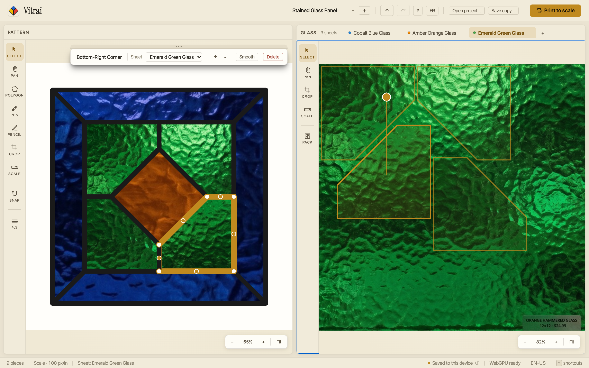
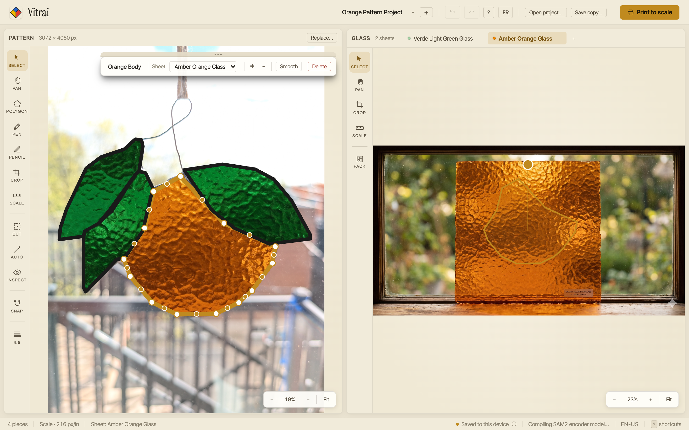
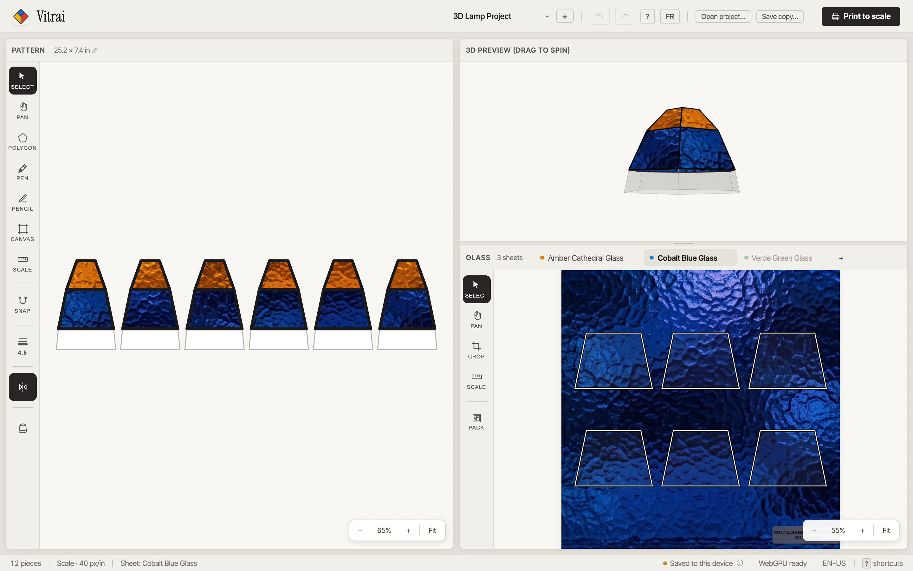
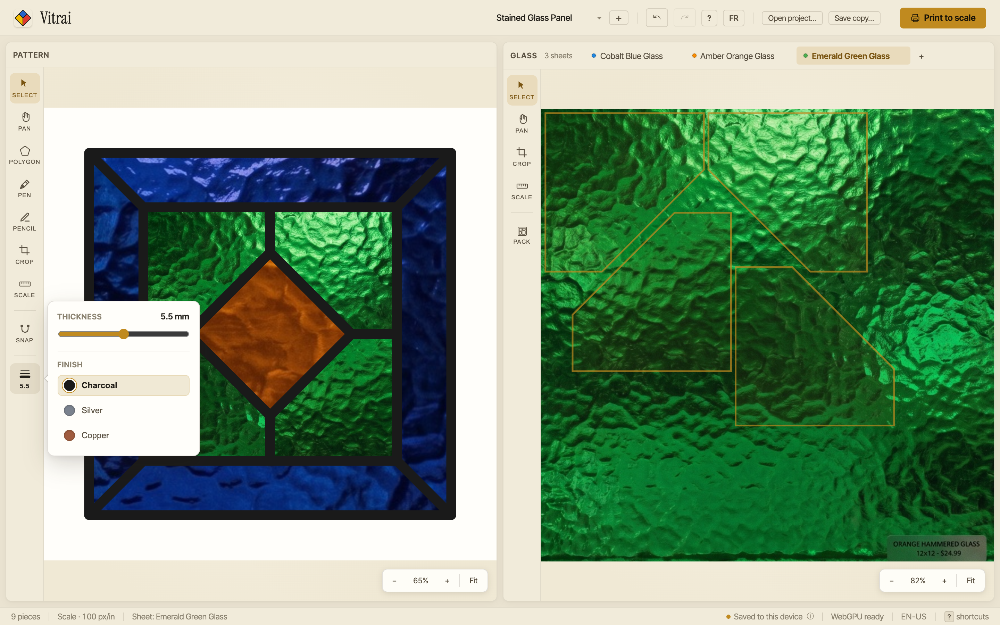

<div align="center">
  
  <h1>Vitrai</h1>
  <p>Stained glass pattern drafting, glass sheet layout, and 3D lampshade design in the browser.</p>
  <p><a href="https://vitrai.dominiquepiche.com"><strong>vitrai.dominiquepiche.com</strong></a></p>
</div>



## Overview

Vitrai is a CAD and material-planning tool for stained glass work. It pairs a 2D pattern editor with calibrated photos of real glass sheets so you can draft pieces, preview how directional grain and color streaks line up across a panel or 3D lampshade, and print 1:1 cutting templates.

Everything runs locally in the browser—user projects stay on your device in the Origin Private File System (OPFS), SAM2 image segmentation runs client-side via WebGPU/WebAssembly, and the built-in glass library streams public sheet textures from Cloudflare R2.

## Capabilities

### Pattern drafting and photo tracing

Draw patterns from scratch with vertex snapping, angle constraints, and curved segments, or import a reference photo and extract piece outlines using on-device SAM2 segmentation alongside manual pen tracing. A reference ruler calibrates the pattern to physical dimensions in inches or centimeters.



### 3D lampshade unrolling

Define a lampshade silhouette from control points to unroll faceted tiers into flat templates. With symmetry enabled, pieces drawn on one facet replicate around the shade and update the 3D preview in real time.



### Glass nesting and 1:1 printing

Import photos of your glass stock, set their physical scale, and position pieces over specific areas of the sheet. The packing tool nests pieces within a sheet's boundaries with a configurable cutting allowance. Adjust solder or came line thickness to check joint spacing, then print tiled 1:1 pages with registration marks.



## Development

```bash
cd frontend
pnpm install
pnpm dev
```

See [`docs/testing.md`](docs/testing.md) for unit and browser regression test commands.

## Deployment

Cloudflare Pages builds from `frontend` (`dist` output). `public/_headers` configures COOP/COEP for `SharedArrayBuffer`, and `functions/glass/[[path]].js` serves the curated glass catalog from the `GLASS_BUCKET` (`vitrai-glass`) R2 binding in Production and Preview (`_routes.json` scopes Function invocations to `/glass/*`). Production serves an immutable release prefix (`/glass/releases/...`); when publishing new glass bytes, update the production URL and the Function's allowed prefix together.
