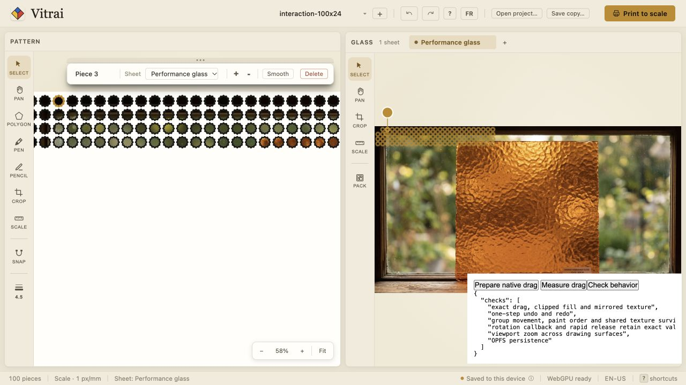

# Selected-piece repaint validation

This follow-up ports only the remaining drawing bottleneck onto current main (`e0573aa`). It builds on the interaction foundations already merged in #123. It does not replace the newer editor tools, group movement, snapping, viewport controls, project schema, or history implementation.

## Change

A single selected piece uses contiguous before/active/after canvas layers. Pattern paint order stays identical. Glass keeps fills clipped, outlines and handles in order, and guides/other overlays on the final drawing surface. Difference debug masks keep their original shared backing canvas. Multi-selection keeps the existing shared-layer arrangement; it is not optimized by this change. Each panel uses at most five layers with one selection.

Selecting a different piece can remount drawing nodes once. A panel-scoped sheet-image resource cache preserves loaded textures through those remounts and releases replaced URLs. ID-based stable callbacks and memoized snap bounds let unrelated Glass outlines remain memoized when snap guides change. Redundant guide values bail out of state updates.

## Evidence

Five-second production-browser drag, 500 pieces × 96 vertices, two samples per display frame, snapping bypassed with Control:

| Measurement | Main before port | After port |
| --- | ---: | ---: |
| p95 frame interval | 50.23 ms | 17.59 ms |
| Frames over 50 ms | 18 | 0 |
| p95 canvas scene/hit CPU work | 11.00 ms | 0.34 ms |
| Input samples processed in five seconds | 238 | 600 |

Evidence: `baseline-main-500-96.json`, `optimized-main-500-96.json`. With normal snapping enabled, the final 500×96 run measured 16.86 ms p95 frame interval and zero frames over 50 ms (`optimized-main-500-96-snapping.json`). The harness dispatches actual Konva gesture handlers against a fixture piece in the real App; this is not a complete pointer-to-paint latency measurement. Frame intervals include display scheduling; canvas CPU timings exclude GPU/compositor presentation. The older checkout's 48-run sweep is not claimed as verification of this port.

Validation includes all 59 existing/new unit tests and the normal production TypeScript/build check. Browser checks exercise exact drag release, clipped fill/mirrored Pattern texture, one-step undo/redo, main's group movement, paint order, shared image identity, rapid rotation release/one-step undo, anchored viewport zoom, and OPFS persistence. These checks also pass against the actual Vite development server with React StrictMode enabled, with no captured warnings or errors. A separate native pointer drag was exported with transform `{x:330,y:170,rotation:0,scale:1}`; one Undo exported the original `{x:30,y:30,rotation:0,scale:1}`, retaining 500 pieces and schema version 1.

Remaining limits: large multi-selection still repaints shared layers; layer surfaces consume more canvas memory; one-time selection remount cost is not separately benchmarked. Physical touch, older hardware, and an exhaustive lamp/tutorial/manual-tool matrix were not tested. Existing geometry, snapping, viewport, Pencil and history tests remain unchanged and passing. The normal build retains its pre-existing large-bundle warning.

## Reproduce

Use the repository's pinned runtime, e.g. prefix commands with `~/.local/bin/mise exec --` on this machine:

```sh
pnpm --dir frontend test
pnpm --dir frontend build
pnpm --dir frontend exec vite build --mode performance
pnpm --dir frontend exec vite preview --outDir dist-performance --port 4280
```

Open `http://localhost:4280/performance/index.html?pieces=500&vertices=96`. Use **Measure drag** or **Check behavior**. Append `&snap=1` to measure with normal snapping. **Prepare native drag** selects the first piece and reports its page coordinates for a native input check. For development StrictMode checks, serve this entry with the Vite dev server and append `&strict=1`; production React does not replay development effects.

Use a dedicated browser origin/port: this fixture intentionally seeds synthetic OPFS project and completed tutorial state there. The normal app build excludes the performance entry and performs no fixture seeding.


